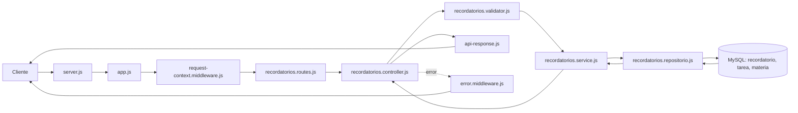

# Relación de archivos para recordatorios

## Flujo de una petición

## Relación y propiedad

El recordatorio no tiene un `id_usuario` propio. Para verificar quién puede verlo o cambiarlo,
el repositorio sigue la relación `recordatorio.id_tarea → tarea.id_tarea → tarea.id_materia →
materia.id_materia` y comprueba `materia.id_usuario` contra el usuario de `request.user.id`.
El listado también incluye el título de la tarea y el nombre y código de la materia relacionada.

Las operaciones de escritura insertan, actualizan o eliminan filas únicamente en `recordatorio`.
Las tablas `tarea`, `materia` y `usuario` se consultan para validar la relación y mostrar contexto;
no se modifican.

## Rutas

| Método | Ruta | Descripción |
| --- | --- | --- |
| GET | `/api/v1/recordatorios` | Lista recordatorios propios con filtros y paginación. |
| GET | `/api/v1/recordatorios/:id` | Consulta un recordatorio propio. |
| POST | `/api/v1/recordatorios` | Crea un recordatorio para una tarea propia. |
| PUT | `/api/v1/recordatorios/:id` | Reemplaza sus campos editables. |
| PATCH | `/api/v1/recordatorios/:id` | Actualiza solo los campos enviados. |
| DELETE | `/api/v1/recordatorios/:id` | Elimina el recordatorio propio. |

El listado acepta `page`, `limit`, `leido`, `canal`, `tareaId`, `search`, `sort` y `order`.
Por defecto ordena por `fechaHora` ascendente, devuelve hasta 20 registros por página y limita
`limit` a 100. Los canales admitidos son `in_app` y `email`.

Los cuerpos usan propiedades en camelCase: `tareaId`, `mensaje`, `fechaHora`, `canal` y `leido`.
En una creación, `canal` toma `in_app` y `leido` toma `false` si se omiten. `fechaHora` acepta
`YYYY-MM-DD HH:mm:ss` o `YYYY-MM-DDTHH:mm:ss` y se guarda en `DATETIME`.
